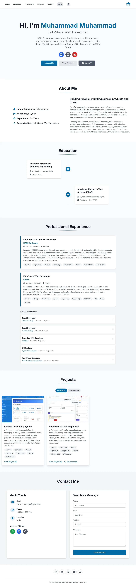
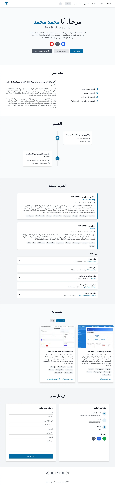

# Muhammad's Portfolio

[](https://github.com/MuhammadGitAcc/Personal-Portfolio/actions/workflows/ci.yml)
[](https://github.com/MuhammadGitAcc/Personal-Portfolio/actions/workflows/lighthouse.yml)

Personal portfolio of Muhammad, a Full-Stack Web Developer: about, education, experience, projects and a contact form, in **English** and **Arabic** (with full right-to-left support), in light and dark mode.

**Live site:** https://moh-port.pages.dev

|                      English                      |                     العربية                      |
| :-----------------------------------------------: | :----------------------------------------------: |
|  |  |

## Tech stack

- [React 19](https://react.dev) and [TypeScript](https://www.typescriptlang.org) (strict mode)
- [Vite](https://vite.dev) for development and builds
- [Tailwind CSS 3](https://tailwindcss.com) and [Framer Motion](https://motion.dev)
- [i18next](https://www.i18next.com) / react-i18next for English and Arabic, with typed translation keys
- [EmailJS](https://www.emailjs.com) for the contact form
- [Vitest](https://vitest.dev) and Testing Library for tests
- ESLint (with jsx-a11y), Prettier, GitHub Actions and Lighthouse CI for quality checks
- [Cloudflare Pages](https://pages.cloudflare.com) for hosting

## Getting started

You need Node.js `^22.22.2`, `^24.15.0` or `>=26` (`.nvmrc` says `22`; with nvm run `nvm use`).

```bash
git clone https://github.com/MuhammadGitAcc/Personal-Portfolio.git
cd Personal-Portfolio
npm ci
cp .env.example .env.local
npm run dev
```

Open the address that Vite prints (usually http://localhost:5173).

### Environment variables

Copy `.env.example` to `.env.local` and fill in the values from your EmailJS dashboard. The file `.env.local` is ignored by git: never commit it.

| Name                       | What it is          |
| -------------------------- | ------------------- |
| `VITE_EMAILJS_SERVICE_ID`  | EmailJS service ID  |
| `VITE_EMAILJS_TEMPLATE_ID` | EmailJS template ID |
| `VITE_EMAILJS_PUBLIC_KEY`  | EmailJS public key  |

The public key is meant to be visible in the browser. Without these values the site still works, but the contact form cannot send messages.

### Scripts

| Command                | What it does                                 |
| ---------------------- | -------------------------------------------- |
| `npm run dev`          | Starts the development server                |
| `npm run build`        | Creates the production build in `dist/`      |
| `npm run preview`      | Serves the production build locally          |
| `npm test`             | Runs all tests once                          |
| `npm run test:watch`   | Runs the tests again on every change         |
| `npm run lint`         | Runs ESLint                                  |
| `npm run typecheck`    | Runs the TypeScript checks                   |
| `npm run format`       | Formats all files with Prettier              |
| `npm run format:check` | Checks the formatting without changing files |

## Project structure

All content lives in data files and translation files. Components only display it.

```
public/                    files served as they are
  _headers                 security headers and cache rules (Cloudflare)
  cv/                      CV PDFs (English and Arabic)
  favicon.*, icon-*.png, apple-touch-icon.png, manifest.webmanifest
  og-image.png             social preview image (1200x630)
  robots.txt, sitemap.xml
src/
  assets/images/projects/  one screenshot per project (named by slug)
  components/
    layout/                Header, Footer, SkipLink
    sections/              Hero, About, Education, Experience, Projects, Contact
    ui/                    small shared pieces (Button, Tag, ProjectCard, Logo, ...)
  data/                    site, social links, navigation, education, experience, projects
  hooks/                   theme, language, direction, active section, header hiding
  i18n/                    setup and locales/en.json, locales/ar.json
  services/                emailService.ts (all EmailJS code)
  types/                   shared TypeScript types
  utils/                   link helpers
  styles/                  index.css (the one stylesheet)
index.html                 page title, description, social tags, structured data
```

Tests sit next to the code they test (`*.test.ts` and `*.test.tsx`).

## How to change things

### Add a project

1. Add a 16:10 WebP screenshot (about 1280x800, under about 150 KB) to `src/assets/images/projects/`, named after the project, for example `my-project.webp`.
2. In `src/data/projects.ts`, import it and add one object to the `projects` list: `slug`, `title`, `description` and `imageAlt` (each in English and Arabic), `image`, `tags`, `category`, `liveUrl`, and `repoUrl` if the code is public.
3. If you use a new category, add it to the `ProjectCategory` type in `src/types/index.ts` and add its name under `projects.categories` in both `en.json` and `ar.json`.

The card, the filter buttons and the tests pick it up by themselves.

### Change a link, the email or the phone number

Edit the one entry in `src/data/social.ts`. The header, hero, footer and contact section all read from it. Links to other sites open in a new tab automatically.

### Change the CV

Replace the PDF files in `public/cv/` (keeping the file names, or updating the two paths in `src/data/social.ts`). A test fails if a path in `social.ts` has no file.

### Change texts, jobs or education

- Name, title, intro and About texts: `src/data/site.ts`.
- Jobs and degrees: add or edit one object in `src/data/experience.ts` or `src/data/education.ts`. Keep the jobs newest first.
- Interface texts (buttons, labels, messages): `src/i18n/locales/en.json` and `ar.json`.

### Add or change a translation

Every visible text has an English and an Arabic version. In the locale files both languages must have the same keys; in the data files every text is `{ en: "...", ar: "..." }`. The tests fail if a key or a language is missing or empty.

### Change the logo, icons or social image

- The header logo is the SVG component `src/components/ui/Logo.tsx`.
- The browser icon is `public/favicon.svg`; the PNG and ICO versions, the Apple icon and the manifest icons are in `public/`.
- The social preview image is `public/og-image.png` (1200x630).

### Change the site address or your name

The site address (`https://moh-port.pages.dev`) is written in `src/data/site.ts`, and in `index.html` (canonical link, `og:url`, image links, structured data), `public/sitemap.xml`, `public/robots.txt`. Your name is in `src/data/site.ts`, `index.html`, `public/manifest.webmanifest`, `public/og-image.png` and the CV files.

## Testing and quality

```bash
npm run typecheck && npm run lint && npm run format:check && npm test && npm run build
```

The tests cover: the page structure and untranslated keys, the menu, theme and language switches (including the page direction), the translation files and data files (English and Arabic complete), the social links and CV files, the projects data, and the security headers.

The same commands run in CI on every pull request, together with a dependency audit and a Lighthouse check. Accessibility, Best Practices, SEO and Performance must each score 0.9 or higher.

## Deployment

`main` is protected: every change goes through a pull request.

1. Create a branch from an up-to-date `main` and push it.
2. Open a pull request. GitHub Actions runs the CI and Lighthouse checks, and Cloudflare Pages builds a preview link.
3. When the checks are green, merge with **Squash and merge**.
4. Cloudflare Pages publishes `main` to https://moh-port.pages.dev automatically (about a minute).

Cloudflare settings, environment variables, security headers and how to roll back are in [DEPLOYMENT.md](DEPLOYMENT.md).

## Security

- Content-Security-Policy and other headers are set in `public/_headers` and guarded by a test.
- The contact form has a hidden honeypot field, strict validation and a cooldown after sending.
- EmailJS values come from environment variables, never from the source code.
- Dependabot opens weekly pull requests for outdated packages.
